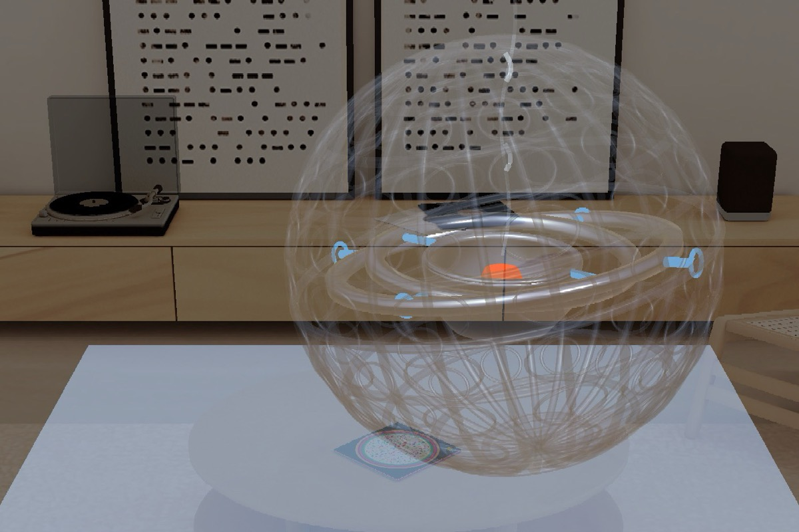
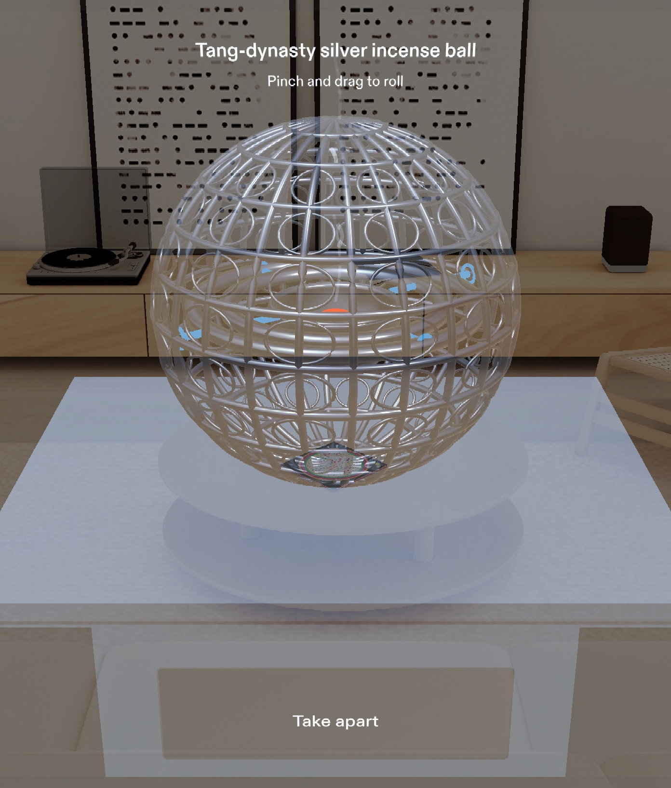
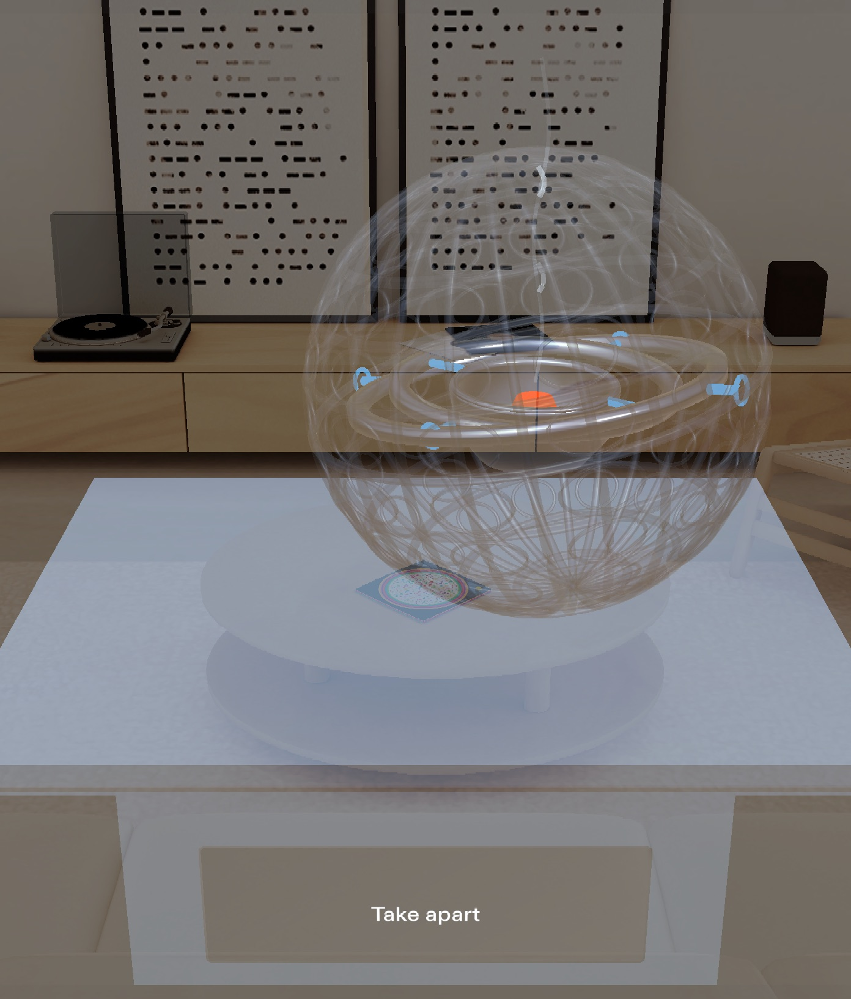
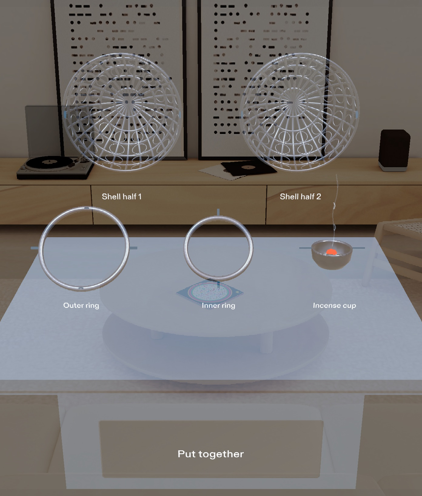
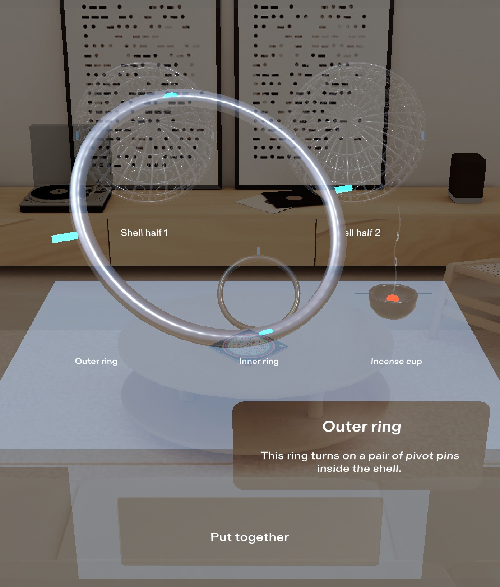

# The Incense Ball

**Roll a Tang-dynasty gimbal on a museum plinth, watch the cup stay level, then take it apart in mid-air.**
A one-object AR exhibit for SPECS, built for [Learn AR with SPECS](https://learn-specs.devpost.com/) and runnable in the Lens Studio preview, so no glasses are needed.

- **Demo video:** _coming soon (YouTube)_
- **Design brief:** [`devpost/design-brief.md`](devpost/design-brief.md)
- **Test results:** [`Assets/Tests/RESULTS.md`](Assets/Tests/RESULTS.md): 5 of 5 done criteria pass in LEAF

## What it does

The original is a palm-sized silver incense ball, more than 1,200 years old, that uses the same gimbal idea as a modern camera stabilizer: *the two rings turn so the cup doesn't have to.* In a museum it sits small and still behind glass, so you never see that happen.

On SPECS, a 30 cm copy stands on a plinth about 90 cm in front of you:

1. **Roll it.** Pinch the ball and drag along the plinth. The shell turns partly see-through, the outer and inner rings swing on their pivot pins, and the cup with its glowing ember stays level while the smoke keeps rising straight up. Let go upside down and nothing spills. After about 2 s the shell fades back to solid silver.
2. **Take it apart.** Pinch **Take apart**. The shell opens like a clam, and the rings and cup slide out along their pivots with a soft click for each step. All five parts settle at half size in two labeled tiers, with the pivot pins highlighted.
3. **Inspect a part.** Point at a part to highlight it, then pinch it. It glides 20 cm toward you at full size, slowly turns to show its pins or pin holes, and a one-sentence card explains its job. Pinch it again to send it back.
4. **Put it together.** Pinch **Put together**. Every part returns exactly where it was, including the shell's rolled orientation, and the ball is ready to roll again.

| Start | Rolling | Taken apart | Inspecting |
|---|---|---|---|
|  |  |  |  |

## Why glasses

An enlarged copy stands in your room, where you can roll it, separate its layers in mid-air, and walk around the parts to see the pivot connections, which are hard to see on a small object behind glass. The exhibit stays anchored in the room while you move, and your hands stay free to pinch and drag.

## Try it in Lens Studio

1. Open `LearnARwithSPECS.esproj` in **Lens Studio 5.23.2**. The project targets SPECS, and Lens Studio regenerates `Cache/` and `Support/` on first open.
2. In the Preview panel, choose the SPECS device and **Interactive Preview**.
3. Use WASD to move, Q/E to go down and up, and right-drag (or hold Shift) to look around. Clicking acts as a pinch: click-drag the ball to roll it, and click the buttons and parts.
4. Stand at the start position and look slightly down at the plinth.

## Tests (LEAF)

Six LEAF scenarios live in `Assets/Tests/`, one per done criterion plus a supplementary direct-reach test. They drive real SIK hover, pinch, and drag events, measure geometry from mesh vertices, and sample the cup's tilt every frame.

| Done criterion | Result | Key measurement |
|---|---|---|
| 1. 30 cm ball on its stand, 90 cm ahead, in view, one "Take apart" button | PASS | 29.99 cm wide, center (0, -30, -90) cm, 0.04 cm off the stand |
| 2. Rolling: see-through shell, rings swing, cup within 5° of level, upside-down release | PASS | max cup tilt 0°, smoke 0°, released at 176.5° |
| 3. Take apart into two half-size tiers within about 3 s, all parts and tags in view | PASS | 2.46 s, 44.7 × 32.1 cm display, 6–7 cm gaps |
| 4. Inspect each part, card shows, others dim, pinch again to return | PASS | all five parts, exact card copy |
| 5. Put together exactly as before, then roll again | PASS | restored within 0.05 cm and 0.1° |
| Supplementary: reach the button with an IK avatar | blocked | the avatar download failed (network), not a Lens failure |

To re-run: open the LEAF panel in Lens Studio and run each scenario in Preview, one at a time. Details and evidence are in [`Assets/Tests/RESULTS.md`](Assets/Tests/RESULTS.md).

**Logic proven** in preview: the five done criteria. **Feel unproven:** real hand tracking, direct reach to the waist-height button, comfort over time, and readability on the glasses themselves.

## How it was built

- **Planned** with the `plan-lens` skill from the [Learn AR with SPECS skill pack](https://github.com/challengepost/learn-specs). The interview produced [`devpost/design-brief.md`](devpost/design-brief.md) with placement, input, timing, copy, and five testable done criteria.
- **Built** by coding agents through Snap's **CLAD** plugin and the **Lens Studio MCP**, from the brief. The first build ran in OpenAI Codex; finalization and verification ran in Claude Code.
- **Geometry** is generated in code with `MeshBuilder`: the openwork shell, the rings with their pivot pins and bearing holes, the lathed cup, the ember, the smoke, and the plinth. There are no imported models.
- **Gimbal:** each frame, `levelMechanism()` derives the outer-ring and inner-ring angles from the shell's rotation so the cup's up axis stays world-up. The smoke sits outside the rotating hierarchy, so it always rises in world space.
- **Interaction** uses Spectacles Interaction Kit (SIK) `Interactable` for pinch and drag. **UI** uses SpectaclesUIKit (`Button`, `BackPlate`, `FlexLayout`). **Sound:** the two soft clicks were synthesized locally with CLAD's build-sfx tool.
- **Display-aware:** SPECS uses an additive display, where black is transparent, so the exhibit uses light silver, glowing pins and ember, and light text.

| Path | What it is |
|---|---|
| `Assets/Scripts/IncenseBallMain.ts` | Exhibit controller: roll, gimbal leveling, take-apart, inspect, put-together |
| `Assets/Scripts/IncenseBallMesh.ts` | MeshBuilder geometry (tubes, lathe, openwork shell, rings, cup) |
| `Assets/Scripts/IncenseBallExhibitUI.ts` | UIKit button, title, roll hint, name tags, inspection card |
| `Assets/Scripts/IncenseBallSceneContracts.ts` | Part names, card copy, display layout |
| `Assets/Tests/` | LEAF scenarios, helpers, and `RESULTS.md` |
| `devpost/design-brief.md` | Approved design brief from `plan-lens` |
| `docs/media/` | Preview screenshots |

## Design notes and known limits

- **Roll hint placement.** The brief puts "Pinch and drag to roll" beside the ball. At the exhibit's distance, the SPECS preview view spans only about ±27 cm sideways (measured from screenshots), so text beside a 30 cm ball would land at the edge of the view or past it. The hint sits just above the ball instead.
- **Not an exact replica.** The ornament and dimensions are not taken from a specific museum object. The historical description comes from the design interview, and no further historical claims are made.
- **Out of scope:** other objects, real-object recognition, voice, multiplayer, and real fire. The ember and smoke are visual effects.

## AI assistance

The Lens, its tests, and this README were written by coding agents (OpenAI Codex and Anthropic Claude Code) using Snap's CLAD plugin, the Lens Studio MCP, and LEAF. The design decisions come from the `plan-lens` interview recorded in the brief.
